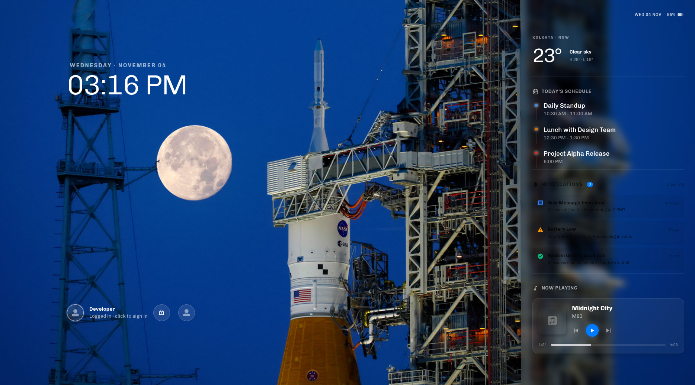

# react-glass-greeter

**react-glass-greeter** is a modern, web-based login and lock screen theme built for Linux systems running **LightDM** and **nody-greeter** (`web-greeter`). It replaces default system greeters with a sleek dark glassmorphism user interface while maintaining a clean, SOLID-compliant architecture under the hood. This project is designed for Linux desktop customization enthusiasts, students, and developers who want an interactive, reliable login experience that can also be easily developed and tested inside a standard web browser.

---

## 💻 Preview

<div style="display: flex; gap: 10px;">
  
  
</div>

## 🚀 Features

- **Dark Glassmorphism UI:** Translucent frosted-glass panels (`backdrop-blur`), subtle borders, and smooth layout transitions.
- **Interactive Multi-User Selection:** Horizontal user avatar list that keeps the active user's metadata expanded while revealing other profiles smoothly on hover or focus.
- **Full Keyboard Navigation:** Cycle through available user profiles on the lock screen using `ArrowLeft` and `ArrowRight`, and open the selected user's login prompt with `Enter` or `Space`.
- **Event-Driven PAM Authentication:** Connects directly to LightDM's `show_prompt` and `authentication_complete` signals for reliable password verification without race conditions, complete with loading states and error shake animations.
- **Hardware & System Status:** Live system date and time display (`DateTime`), dynamic battery percentage and charging status icons (`Battery`), and real-time **Caps Lock** state detection on the password input.
- **System Power Controls:** Quick-access footer (`SystemAction`) to switch users, restart, or shut down the machine based on system policy permissions.
- **Browser Development Mock Layer:** Decoupled `GreeterService` (`WebGreeter`) abstraction that automatically falls back to mock users, battery data, and simulated authentication (`1234` or `admin`) when `window.lightdm` is unavailable, allowing full UI development in a standard browser.

---

## 🛠️ Tech Stack

| Category                 | Technology                                           |
| ------------------------ | ---------------------------------------------------- |
| Language                 | TypeScript                                           |
| Frontend Framework       | React                                                |
| Routing                  | React Router (`createMemoryRouter`)                  |
| Styling                  | Tailwind CSS                                         |
| Animation & UI Libraries | Motion (`motion/react`), React Icons (`react-icons`) |
| System Integration       | LightDM, `nody-greeter` (`nody-greeter-types`)       |
| Build Tool               | Vite (with React Compiler)                           |

---

## ⚙️ Prerequisites & Installation

Before installing and deploying the theme, make sure your Linux system and development environment have the following tools installed:

- **Node.js** and **pnpm** (or **npm**)
- **Git**
- **LightDM** and **nody-greeter** (configured as your active LightDM greeter)
- **acl** (`setfacl`, required only if deploying via symlink from your home directory)

**Step 1: Clone the repository**

```bash
git clone [https://github.com/ravirajkarn/react-glass-greeter.git](https://github.com/ravirajkarn/react-glass-greeter.git)
cd react-glass-greeter

```

_(Note: Replace the repository URL above if you are cloning from a fork or a different remote.)_

**Step 2: Install dependencies**

Using **pnpm** (recommended):

```bash
pnpm install

```

Or using **npm**:

```bash
npm install

```

**Step 3: Build and install the theme to LightDM**

You can use the included `install.sh` script to build the production bundle, copy or symlink it to `/usr/share/web-greeter/themes/react-glass-greeter`, and update `/etc/lightdm/web-greeter.yml`:

```bash
chmod +x install.sh

# Option A: Standard copy installation (copies dist/ to /usr/share/web-greeter/themes/)
./install.sh

# Option B: Symlink installation for active development (links dist/ and configures ACL permissions for lightdm)
./install.sh --symlink

```

---

## 💻 Usage

### Running in Local Browser Development Mode

You can develop and preview the UI inside a regular browser without logging out of your desktop session. When `window.lightdm` is not detected, the app automatically switches to `MockGreeterService`.

**Start the development server:**

```bash
# Confirm your exact dev script in package.json (e.g., pnpm run dev)
pnpm run dev

```

Open the local URL displayed in your terminal (typically `http://localhost:5173`).

- **Lock Screen (`/`):** Use `ArrowLeft` / `ArrowRight` or hover over user avatars to inspect profiles, and click or press `Enter` / `Space` to proceed to login.
- **Login Screen (`/login`):** Type the mock password (`1234` or `admin`) to simulate a successful login, or enter any other password to test the error shake animation and password reset behavior.

### Building for Production & Testing in `nody-greeter`

**Build the production bundle:**

```bash
pnpm run build

```

**Preview safely inside your active desktop session:**

Before locking your system, test the compiled theme with the real `window.lightdm` bridge in a debug window:

```bash
nody-greeter --debug

```

**Lock your screen to test the live greeter:**

```bash
dm-tool lock

```

---

## 🤝 Contributing

Contributions from students, beginners, and fellow open-source developers are always welcome! Whether you are fixing a bug, refining an animation, or improving documentation, your help is appreciated.

### How to Contribute

1. **Fork** the repository on GitHub.
2. **Create** a new branch for your feature or bug fix.
3. **Make** your changes and ensure the code builds cleanly without TypeScript or linter warnings.
4. **Test** your changes in both browser development mode and `nody-greeter --debug`.
5. **Commit** and **push** your changes to your fork.
6. **Submit** a Pull Request with a clear explanation of what you changed and why.

```bash
git checkout -b feature/your-feature-name
git add .
git commit -m "Add: describe your changes"
git push origin feature/your-feature-name

```

### Community Guidelines

- **Report Bugs:** Found an issue? Open a ticket under **GitHub Issues** with steps to reproduce.
- **Suggest Enhancements:** Have an idea for a new feature (such as a desktop session switcher or custom background settings)? Feel free to open an issue to discuss it.
- **Follow Project Conventions:** Keep components modular, maintain TypeScript type safety, and route any `window.lightdm` interactions through the `WebGreeter` service layer (`src/services/WebGreeter.ts`).

---

## 📄 License

This project is distributed under the **MIT License**. You are free to use, modify, distribute, and use this software for private or commercial purposes, subject to the terms of the license.

This project is licensed under the MIT License.
See the [LICENSE](./LICENSE) file for details.
